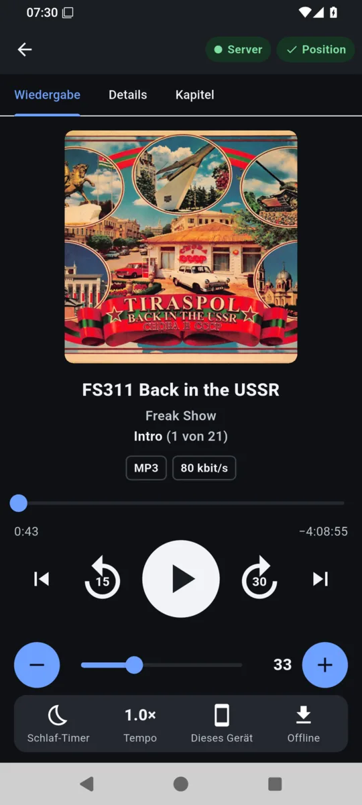
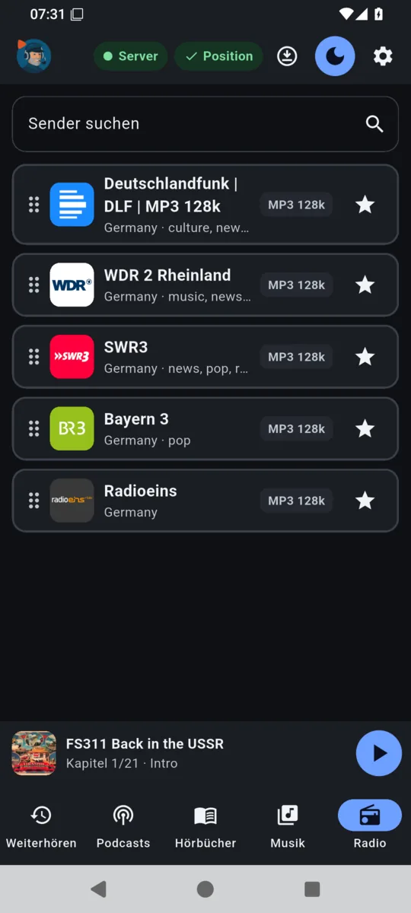
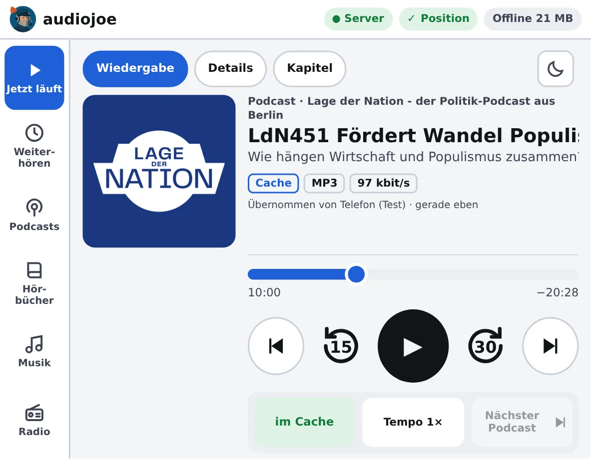

  

# audiojoe

[English](README.md) · **Deutsch**

> **Eine Stelle für alles Hörbare: Podcasts, Hörbücher, Musik und Internetradio – mit
> Hörständen, die zwischen Telefon, Rechner, Auto und Sonos mitwandern.**
> Der eigene Server verbindet Jellyfin, Emby, Plex, Audiobookshelf, Podcast-Feeds und das freie
> Radioverzeichnis Radio Browser; Apps für Android, Linux und Windows sowie ein Web-Player für den
> Browser im Auto spielen ab, auch offline.
>
> **Keine Telemetrie:** audiojoe sendet keine Nutzungsdaten. Der Server verbindet sich nur mit den
> Quellen und Diensten, die du einrichtest oder nutzt – alle Zugriffe:
> [Datenschutz](docs/DATENSCHUTZ.md).

  

  
  &nbsp;
  
  &nbsp;
  
  &nbsp;
  
  &nbsp;
  

Der Server speichert **keine Medien**. Er kennt Quellen, Titel und Hörstände und reicht den Ton per
HTTP durch; zwischengespeichert wird nur auf den Geräten.

- **Weiterhören überall:** Jede Position geht sofort an den Server. Das nächste Gerät setzt dort
  fort – bei einem Album samt Warteschlange – und zeigt, von wo es übernommen hat.
- **Kapitel:** aus der Kapiteldatei (Podcasting 2.0), Podlove-Kapiteln im Feed oder den
  Kapitelmarken in der MP3; ⏮ ⏭ springen von Kapitel zu Kapitel.
- **Qualität im Blick:** Codec, Bittiefe und Abtastrate an jedem Titel; Hi-Res wird nur
  umgerechnet, wo ein Ziel es nicht abspielen kann.

## Dokumentation

*Die Dokumentation beschreibt das aktuelle Release. Für eine ältere Version gilt `docs/` unter dem
Schild dieser Version (`https://github.com/joeMJ/audiojoe/tree/vX.Y.Z/docs`). Die im Server
eingebauten Hilfeseiten unter `/docs/` passen immer zur installierten Version.*

- [`docs/install-server.md`](docs/install-server.md) – Server installieren (Proxmox, Ubuntu Server, Paket, Quelltext), HTTPS-Proxy, Sonos
- Apps: [Ubuntu](docs/install-ubuntu.md) · [Debian](docs/install-debian.md) · [Windows](docs/install-windows.md) · [Android](docs/install-android.md)
- [`docs/ERSTE-SCHRITTE.md`](docs/ERSTE-SCHRITTE.md) – Benutzer, Anmeldung, Quellen, Podcasts, Radio, Musik
- [`docs/ANLEITUNG.md`](docs/ANLEITUNG.md) – Bedienung: Weiterhören, Player, Kapitel, Offline, im Auto
- [`docs/DATENSCHUTZ.md`](docs/DATENSCHUTZ.md) – alle Netzzugriffe und was wo gespeichert wird
- [`docs/ARCHITEKTUR.md`](docs/ARCHITEKTUR.md) – so arbeitet audiojoe: Netzschema und wo Daten liegen
- [`docs/SECURITY-COMPONENTS.md`](docs/SECURITY-COMPONENTS.md) – über HTTPS erreichbare Bibliotheken, vor und nach der Anmeldung (bei welcher Schwachstelle ein Update anzuraten ist)
- [`docs/BACKUP.md`](docs/BACKUP.md) – Sicherung und Wiederherstellung: was zu sichern ist, stimmige Kopien, Zurückspielen, nach Verlust des Servers
- [`docs/BETRIEB.md`](docs/BETRIEB.md) – audiojoe sicher betreiben: Ports und Firewall, Container und Dienst, Konten, Updates und der Weg zurück, Internet
- [`docs/TROUBLESHOOTING.md`](docs/TROUBLESHOOTING.md) – Fehlerbehebung: Server, Proxy, Ton, Sonos, Abgleich, Updates, beschädigte Datenbank
- [`THIRD_PARTY.md`](THIRD_PARTY.md) – verwendete Bibliotheken Dritter und Datenquellen mit Lizenzen

> [!WARNING]
> **Privates Hobbyprojekt – nicht gepflegt / unmaintained.**
> Dieses Repository ist für meinen eigenen Gebrauch gedacht und wird nur aus Bequemlichkeit öffentlich bereitgestellt.
>
> * **Keine Unterstützung zugesagt:** Pull Requests werden nicht bearbeitet, Feature-Wünsche nicht zugesagt. Fehler und Wünsche können gemeldet werden (siehe [Fehler melden und Wünsche](#fehler-melden-und-wünsche)) – es kann aber dauern, bis sie bearbeitet werden.
> * **Keine Garantie, Haftung:** Das Programm wird unentgeltlich als Privatprojekt „wie besehen“ bereitgestellt. Es besteht kein Anspruch auf Verfügbarkeit, Fehlerfreiheit, Aktualisierungen oder Support. Für Schäden aus der Nutzung hafte ich nur bei Vorsatz, grober Fahrlässigkeit sowie bei Verletzung von Leben, Körper oder Gesundheit; im Übrigen nur nach den gesetzlichen Vorschriften.
> * **Eigene Umgebung:** Entwickelt und getestet nur in meiner eigenen Umgebung (Server in einem Debian-13-Container unter Proxmox, Android, Ubuntu, Tesla). Auf anderen Systemen kann es fehlschlagen.
> * **Netzwerk:** Der Server verbindet sich mit den Quellen, die du einträgst. Welche Zugriffe es sonst gibt, steht in [`docs/DATENSCHUTZ.md`](docs/DATENSCHUTZ.md). **Lies den Code, bevor du ihn installierst.**
> * **Keine Updates zugesichert:** Es kann jederzeit ohne Ankündigung Änderungen, Brüche oder die Löschung des Repos geben.
>
> *Private hobby project, unmaintained, provided as-is. No guaranteed support, no warranty.*

  
  &nbsp;
  
   
  <em>Player einer Podcast-Folge mit Kapiteln · Radio-Favoriten</em>
    
  
   
  <em>Web-Player im Format des Tesla-Bildschirms, übernommen vom Telefon</em>

---

## Plattform-Übersicht

| Teil | Status | Hinweis |
| :--- | :--- | :--- |
| **Server** (Debian 13, Ubuntu 24.04 / 26.04) | Entwicklung | Paket, Proxmox-Skript (Container), Ubuntu-Skript (VM) – [Server installieren](docs/install-server.md#server) |
| **Android** | Entwicklung | signierte APK |
| **Linux (Ubuntu 24.04 / 26.04, Debian 13)** | Entwicklung | `.deb` |
| **Windows 10/11** | Entwicklung | MSI, signiert |
| **Web-Player** | Entwicklung | liefert der Server aus; für den Browser im Auto gebaut |

## Was audiojoe kann

- **Quellen:** Jellyfin, Emby, Plex und Audiobookshelf; die Zugangsschlüssel bleiben auf dem Server.
- **Podcasts:** Abonnements per Suche ([fyyd](https://fyyd.de)) oder Feed-Adresse, OPML-Import
  und -Export, neueste Folgen, Shownotes, Kapitel; Feeds werden stündlich aktualisiert.
- **Internetradio:** Sendersuche über [Radio Browser](https://www.radio-browser.info), Favoriten
  in eigener Reihenfolge.
- **Hörbücher** (Audiobookshelf, Jellyfin, Emby, Plex): nach Autor, Serie („x von y gehört“,
  nächster Band), Titel; Hörbücher aus mehreren Dateien; Hörfortschritt mit Audiobookshelf
  abgeglichen.
- **Musik:** eigenes Albenverzeichnis je Bibliothek mit Alben, Künstlern, Samplern, Genres,
  Jahren, Neuzugängen und Labels (aus den Tags, von Plex oder auf Wunsch von
  [MusicBrainz](https://musicbrainz.org)); Bibliotheken je Benutzer ausblendbar.
- **Weiterhören-Listen** für Podcasts, Hörbücher und Alben; **Next** hängt ans Ende an.
- **Player:** Kapitel, Schlaf-Timer (Minuten, Kapitel- oder Titelende), Tempo, Sperrbildschirm
  und Benachrichtigung.
- **Sonos:** Räume und Gruppen, Lautstärke je Raum und Gruppe, Schlummern (Schlaf-Timer des Lautsprechers); Hi-Res wird für S1/S2 passend
  umgerechnet; die Position wird gespeichert.
- **Offline:** in der App und im Web-Player (auch im Auto), mit Positionen, die nachgereicht
  werden.
- **Deutsch und Englisch**, hell und dunkel.

## Datenschutz

audiojoe sendet keine Nutzungsdaten und hat keine Telemetrie. Alle Netzzugriffe im Einzelnen und
was der Server und die Geräte speichern: [`docs/DATENSCHUTZ.md`](docs/DATENSCHUTZ.md).

## Datenquellen

- **[Radio Browser](https://www.radio-browser.info):** freies, von Freiwilligen gepflegtes
  Verzeichnis der Internetradio-Sender. Die Streams und Logos kommen direkt von den Sendern.
- **[fyyd](https://fyyd.de):** Podcast-Verzeichnis für die Suche.
- **[MusicBrainz](https://musicbrainz.org)** (nur wenn eingeschaltet): Labels von Alben;
  Kerndaten unter [CC0](https://musicbrainz.org/doc/About/Data_License).

Podcasts, Cover und Medien kommen von ihren Anbietern bzw. aus den eigenen Quellen; audiojoe
liefert keine mit.

## Fehler melden und Wünsche

Über die [Issues bei GitHub](https://github.com/joeMJ/audiojoe/issues) (GitHub-Konto nötig). Es
kann dauern, bis ein Issue bearbeitet wird.

Hilfreich sind:

- Version (**Einstellungen → Über audiojoe**) und Gerät (z. B. Android 15, Ubuntu 26.04, Tesla)
- Quelle (Podcast, Radio, Jellyfin …) und was genau passiert
- Schritte, mit denen sich der Fehler wiederholen lässt, und der Wortlaut einer Meldung

**Nie mitschicken:** Passwörter, TOTP-Schlüssel, Zugangsschlüssel von Quellen und die
Konfigurationsdatei des Servers. Interne Adressen und Namen in Bildschirmfotos bitte unkenntlich
machen.

## Lizenz

Apache-2.0, siehe [LICENSE](LICENSE). Bibliotheken Dritter, Datenquellen und ihre Lizenzen:
[THIRD_PARTY.md](THIRD_PARTY.md).
