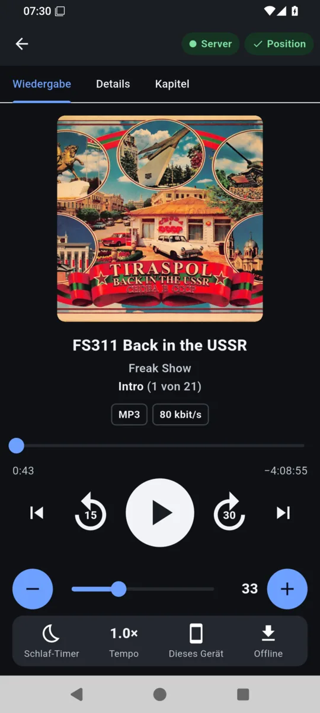
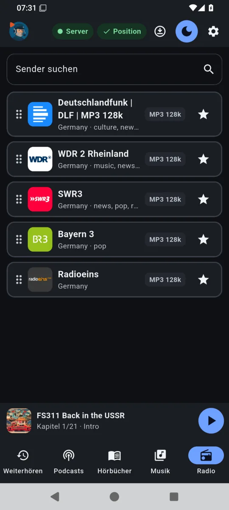
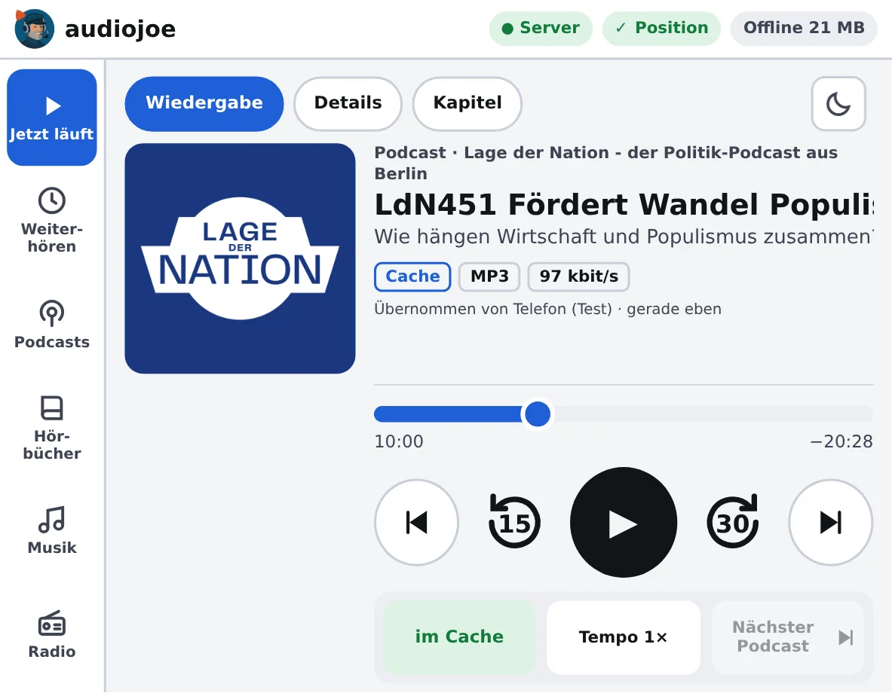

  

# audiojoe

**English** · [Deutsch](README.de.md)

> **One place for everything you listen to: podcasts, audiobooks, music and internet radio –
> with playback positions that travel between phone, desktop, car and Sonos.**
> Your own server connects Jellyfin, Emby, Plex, Audiobookshelf, podcast feeds and the free radio
> directory Radio Browser; apps for Android, Linux and Windows and a web player for the in-car
> browser play it all, offline too.
>
> **No telemetry:** audiojoe sends no usage data. The server only connects to the sources and
> services you set up or use – every access: [Privacy](docs/DATENSCHUTZ.en.md).

  

The server stores **no media**. It knows sources, titles and positions and relays the audio over
HTTP; caching happens on the devices only.

- **Continue anywhere:** every position goes to the server at once. The next device continues
  there – for an album with its queue – and shows where it took over from.
- **Chapters:** from the chapter file (Podcasting 2.0), Podlove chapters in the feed or the chapter
  marks in the MP3; ⏮ ⏭ jump from chapter to chapter.
- **Quality at a glance:** codec, bit depth and sample rate on every title; hi-res is only
  converted where a target cannot play it.

## Documentation

- [`docs/INSTALLATION.en.md`](docs/INSTALLATION.en.md) – build and set up the server, HTTPS proxy, Sonos, apps
- [`docs/ERSTE-SCHRITTE.en.md`](docs/ERSTE-SCHRITTE.en.md) – getting started: users, sign-in, sources, podcasts, radio, music
- [`docs/ANLEITUNG.en.md`](docs/ANLEITUNG.en.md) – manual: continue listening, player, chapters, offline, in the car
- [`docs/DATENSCHUTZ.en.md`](docs/DATENSCHUTZ.en.md) – privacy: every network access and what is stored where
- [`THIRD_PARTY.md`](THIRD_PARTY.md) – third-party libraries and data sources with licences (German)

> [!WARNING]
> **Private hobby project – unmaintained.**
> This repository is meant for my own use and is only published for convenience.
>
> * **No support promised:** pull requests are not handled, feature requests are not promised. Bugs and wishes can be reported (see [Reporting bugs and wishes](#reporting-bugs-and-wishes)) – it may take a while until they are looked at.
> * **No warranty, liability:** the program is provided free of charge as a private project "as is". There is no claim to availability, freedom from errors, updates or support. I am only liable for damage from its use in cases of intent, gross negligence and injury to life, body or health; otherwise only as provided by law.
> * **Own environment:** developed and tested only in my own environment (server in a Debian 13 container on Proxmox, Android, Ubuntu, Tesla). It may fail elsewhere.
> * **Network:** the server connects to the sources you enter. Any other access is listed in [`docs/DATENSCHUTZ.en.md`](docs/DATENSCHUTZ.en.md). **Read the code before you install it.**
> * **No updates guaranteed:** changes, breakage or deletion of the repository may happen at any time without notice.

  
  &nbsp;
  
   
  <em>Player of a podcast episode with chapters · radio favourites (German interface)</em>
    
  
   
  <em>Web player in the size of the Tesla screen, taken over from the phone</em>

---

## Platforms

| Part | Status | Note |
| :--- | :--- | :--- |
| **Server** (Debian 13, LXC) | development | from source ([Installation](docs/INSTALLATION.en.md#server)); package and Proxmox script follow with `v0.1.0` |
| **Android** | development | signed APK |
| **Linux (Ubuntu 24.04 / 26.04)** | development | `.deb` |
| **Windows 10/11** | development | installer to follow |
| **Web player** | development | served by the server; built for the in-car browser |

## What it does

- **Sources:** Jellyfin, Emby, Plex and Audiobookshelf; the access keys stay on the server.
- **Podcasts:** subscribe by search ([fyyd](https://fyyd.de)) or feed address, OPML import and
  export, latest episodes, show notes, chapters; feeds are refreshed every hour.
- **Internet radio:** station search via [Radio Browser](https://www.radio-browser.info),
  favourites in your own order.
- **Audiobooks** (Audiobookshelf, Jellyfin, Emby, Plex): by author, series ("heard x of y", next
  volume), title; books made of several files; progress kept in sync with Audiobookshelf.
- **Music:** the server's own album index per library with albums, artists, samplers, genres,
  years, recently added and labels (from the tags, from Plex or, if you like, from
  [MusicBrainz](https://musicbrainz.org)); libraries can be hidden per user.
- **Continue lists** for podcasts, audiobooks and albums; **Next** appends at the end.
- **Player:** chapters, sleep timer (minutes, end of chapter or title), speed, lock screen and
  notification.
- **Sonos:** rooms and groups, volume per room and group; hi-res is converted to suit S1/S2; the
  position is saved.
- **Offline:** in the app and in the web player (in the car too), with positions sent later.
- **English and German**, light and dark.

## Privacy

audiojoe sends no usage data and has no telemetry. Every network access and what the server and
the devices store: [`docs/DATENSCHUTZ.en.md`](docs/DATENSCHUTZ.en.md).

## Data sources

- **[Radio Browser](https://www.radio-browser.info):** a free directory of internet radio
  stations kept by volunteers. Streams and logos come straight from the stations.
- **[fyyd](https://fyyd.de):** podcast directory for the search.
- **[MusicBrainz](https://musicbrainz.org)** (only when switched on): album labels; core data
  under [CC0](https://musicbrainz.org/doc/About/Data_License).

Podcasts, covers and media come from their publishers or your own sources; audiojoe ships none.

## Reporting bugs and wishes

Through the [issues on GitHub](https://github.com/joeMJ/audiojoe/issues) (GitHub account needed).
It may take a while until an issue is looked at.

Helpful are:

- version (**Settings → About audiojoe**) and device (e.g. Android 15, Ubuntu 26.04, Tesla)
- source (podcast, radio, Jellyfin …) and what exactly happens
- steps that reproduce the bug, and the exact wording of a message

**Never include:** passwords, TOTP secrets, access keys of sources and the server's
configuration file. Please make internal addresses and names in screenshots unrecognisable.

## Licence

Apache-2.0, see [LICENSE](LICENSE). Third-party libraries, data sources and their licences:
[THIRD_PARTY.md](THIRD_PARTY.md).
