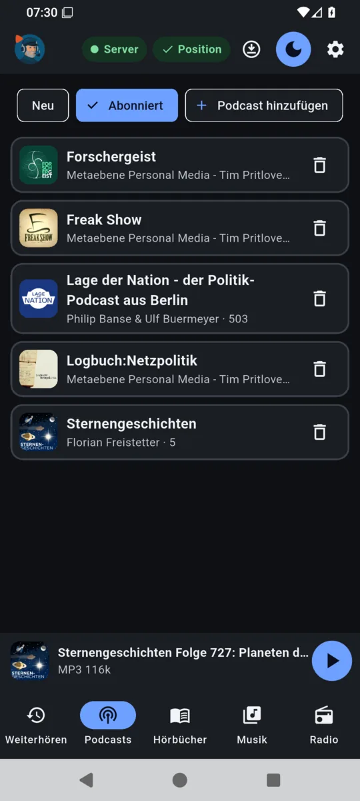
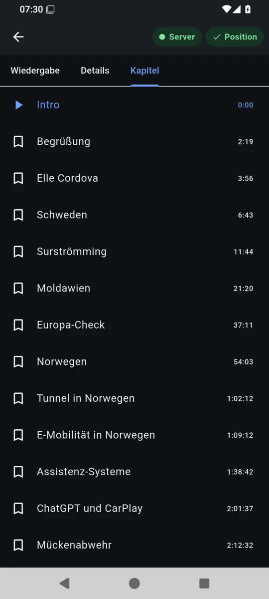
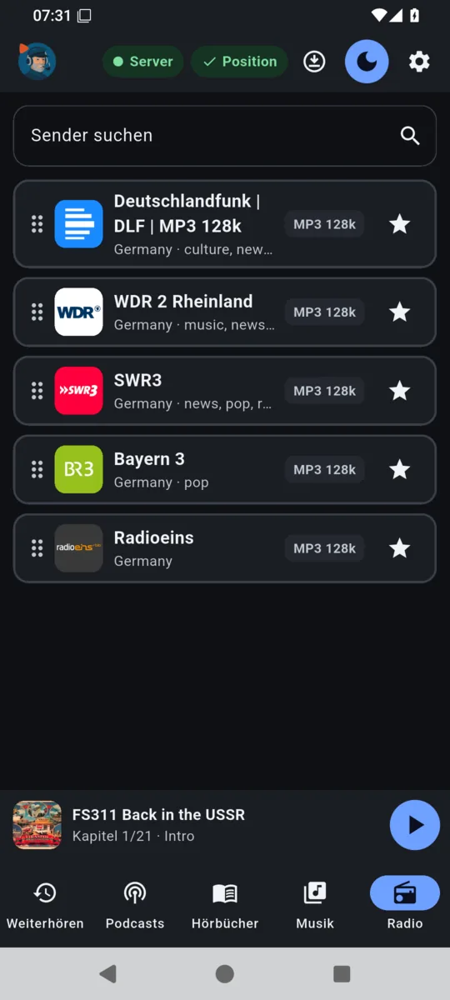
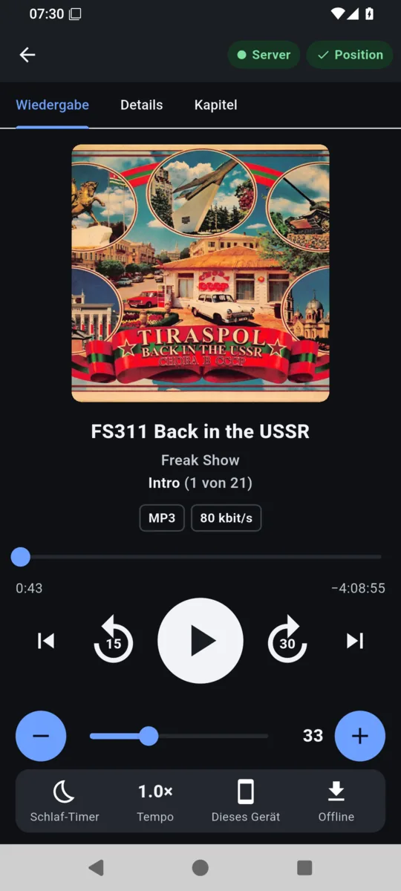
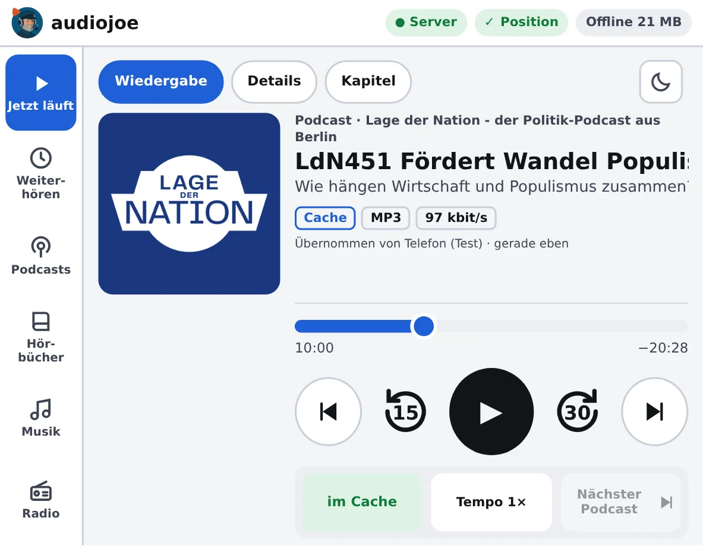
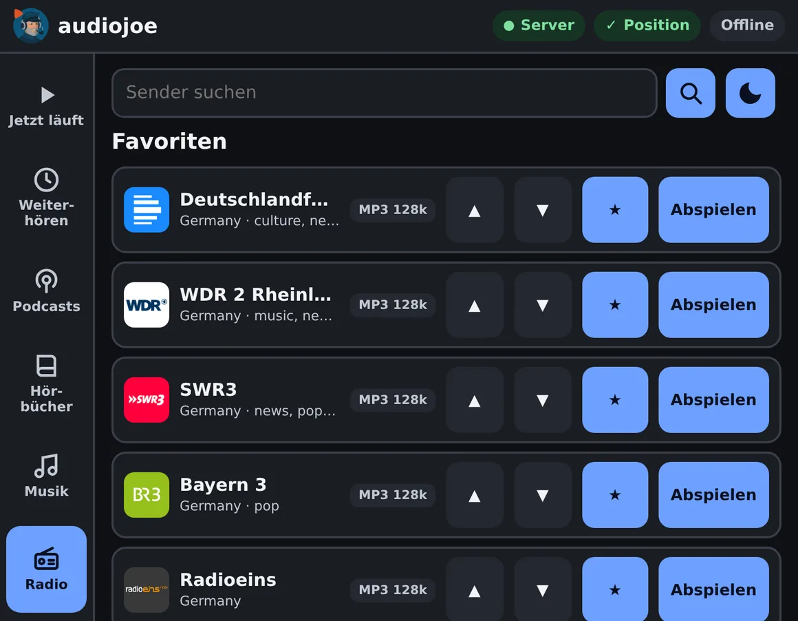

# Manual

*This page describes the current release. For an older version, see the same page under that
version's tag on GitHub (`https://github.com/joeMJ/audiojoe/tree/vX.Y.Z/docs`). The help pages
built into your server under `/docs/` always match the installed version.*

audiojoe has five areas: **Continue**, **Podcasts**, **Audiobooks**, **Music** and **Radio**. The
app shows them at the bottom (phone) or on the left (desktop, web player). At the top are the state
of the connection and of the positions, the button for offline titles, light/dark and the settings.
The screenshots show the German interface.

## State at the top

- **● Server** green: the server is reachable. **Offline · cache** yellow: no connection; the app
  plays what is saved offline and remembers the positions.
- **✓ Position** green: all positions are with the server. Red with **✕** only when a position
  could not be saved for more than 30 seconds; it is sent as soon as the server is reachable again.

## Continue

Started episodes and audiobooks come to the top by themselves; with **Next** (list-with-plus icon)
you append episodes, audiobooks or whole albums at the end. At the end of a title the next entry of
the same list plays. Drag to change the order; the bin takes an entry out (for episodes and
audiobooks: **Mark as heard**).

## Podcasts

**New** shows the latest episodes of all subscriptions, **Subscribed** the podcasts themselves.
Per episode: play, **Next**, save offline. Show notes and chapters are in the player under
**Details** and **Chapters**.

  
  &nbsp;
  
   
  <em>Subscribed podcasts · chapters of an episode</em>

## Radio

Search for stations, keep them as favourites with the star, drag the favourites into order. Radio
plays live; it cannot be saved offline.

  
   
  <em>Radio favourites (station directory: Radio Browser)</em>

## Audiobooks and music

- **Audiobooks** (Audiobookshelf, Jellyfin, Emby, Plex): by author, series ("heard x of y", next
  volume), title or recently added; search by title, author, series and narrator. With Jellyfin
  ("Books" library), Emby ("Audiobooks") and Plex (a music library with the Audnexus agent or
  "Audiobooks" in its name) a folder is a book and the album artist the author; these sources
  know no series or narrators.
- **Music** (Jellyfin, Emby, Plex): albums, artists, samplers, genres, years, recently added and
  labels; search by title, artist, genre and label. **Play album** plays the whole album; ⏮ ⏭ jump
  between its titles.

## Player

  
   
  <em>Player of a podcast episode with chapters</em>

- **Title and place:** in an album "(3 of 14)" follows the title; for episodes and audiobooks with
  chapters "(1 of 21)" follows the chapter. A title too long for the line flows through.
- **Quality:** codec, bit rate, bit depth and sample rate. Lossless formats (FLAC, ALAC, PCM) are
  yellow at 16 bit and red from 24 bit. Conversion or playback from the cache is shown too.
- **Controls:** 15 seconds back, 30 seconds forward. With chapters ⏮ ⏭ jump to the previous or
  next chapter (⏮ within the first 3 seconds of a chapter to the previous one, otherwise to its
  start), otherwise to the previous or next title. Lock screen and notification do the same.
- **At the bottom:** **Sleep timer** (5 to 60 minutes, end of chapter, end of title), **Speed**,
  **Output** (this device or a Sonos room) and **Offline**.
- **Volume:** the device's, with Sonos the room's or group's; rooms can be added to or taken out of
  the group.

## Continue on other devices

Every position goes to the server at once; the other devices follow as long as they are not
playing themselves. At the next start a device continues where you listened last – also when that
was on another device – and briefly shows "Taken over from …". If an album was playing there, the
whole album comes along, with ⏮ ⏭ and the next title.

## Offline

Episodes, audiobooks and albums are saved with the down arrow. The button at the top (app) or
**Offline** (web player) shows what is saved; the web player also how much space it takes. The web
player saves hi-res FLAC as 48 kHz so that it plays in the car. In the web player **Remove played
media from the cache** tidies up after listening.

## In the car (web player)

The web player is built for the in-car browser (large buttons, controls docked at the bottom).
Instead of the sleep timer it has **Next podcast** or **Next album**: the episode counts as heard
(the album leaves the list) and the next entry of **Continue** starts. Audiobooks have no such
button. On screens narrower than the Tesla's (less than 420 px right of the cover) the three
buttons stack under the cover; the controls stay at the bottom right. Links in show notes are
shown as text only.

  
   
  <em>Web player in the size of the Tesla screen: episode with chapters, just taken over from the phone (the note shows only briefly)</em>
    
  
   
  <em>Radio favourites in the web player</em>

## Sync with other podcast apps

audiojoe speaks the gpodder.net API that AntennaPod, Kasts, gPodder and other podcast apps use
for syncing: subscriptions and listening positions are then the same in both worlds. Those apps
cannot enter a code from the authenticator app, so they get a separate **app password**: create
it in the audiojoe app under **Settings → Sync with other podcast apps** (shown once). In the
other app choose the **custom server** under gpodder.net sync and enter the address of your
audiojoe server, your user name and the app password. The app password is valid for the sync
only, for nothing else; **Switch off** signs all apps connected this way out.

## Settings

Sources and libraries, music (album index, MusicBrainz), Sonos (speakers), maintenance (server and
Debian updates, backups, this app's version; see [Installation](install-server.en.md#updates-and-maintenance)),
podcasts (OPML), devices
(signed-in devices, sign out each one), **Sign out this device** and **About audiojoe** with
version, manual, privacy and the third-party licences. In the web player signing out and
**About audiojoe** are at the bottom of the **Offline** page. See [Getting started](ERSTE-SCHRITTE.en.md).
