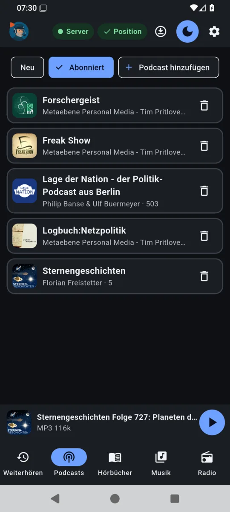
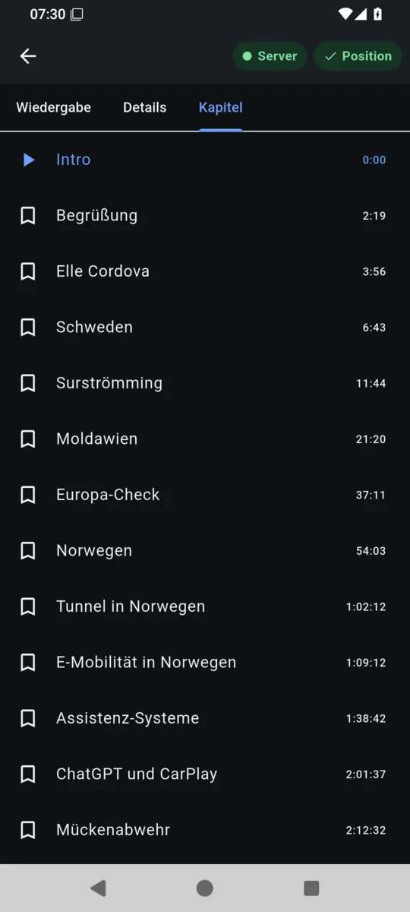
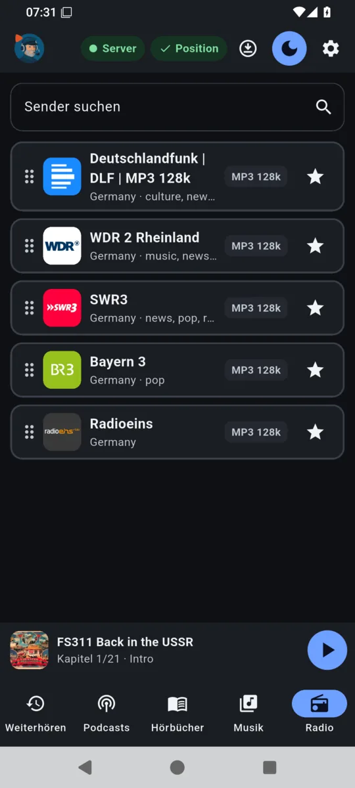
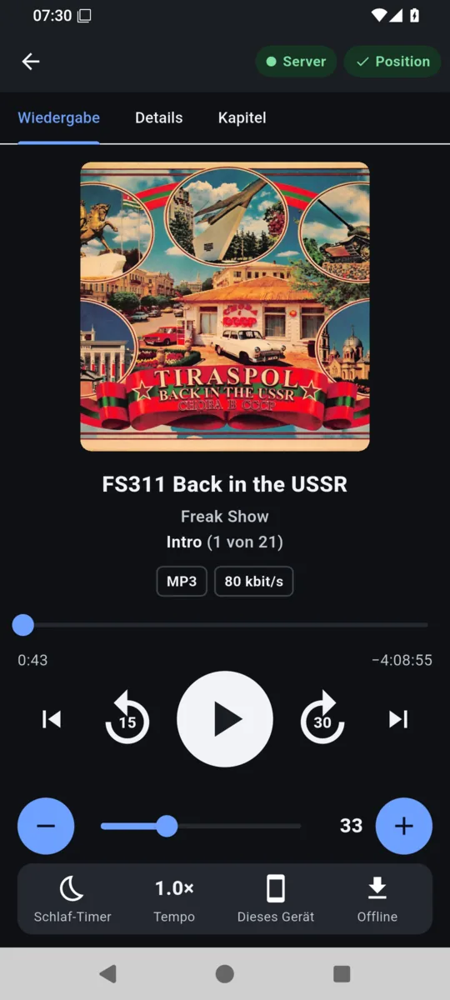
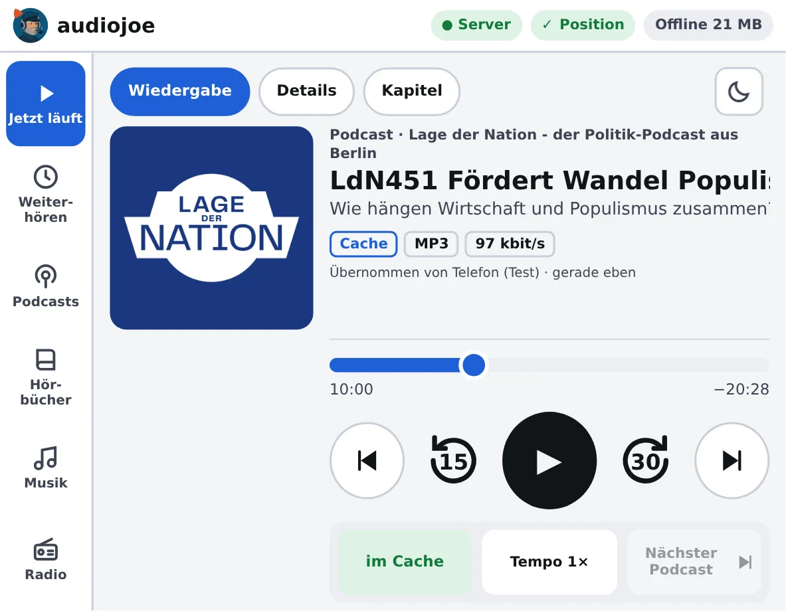
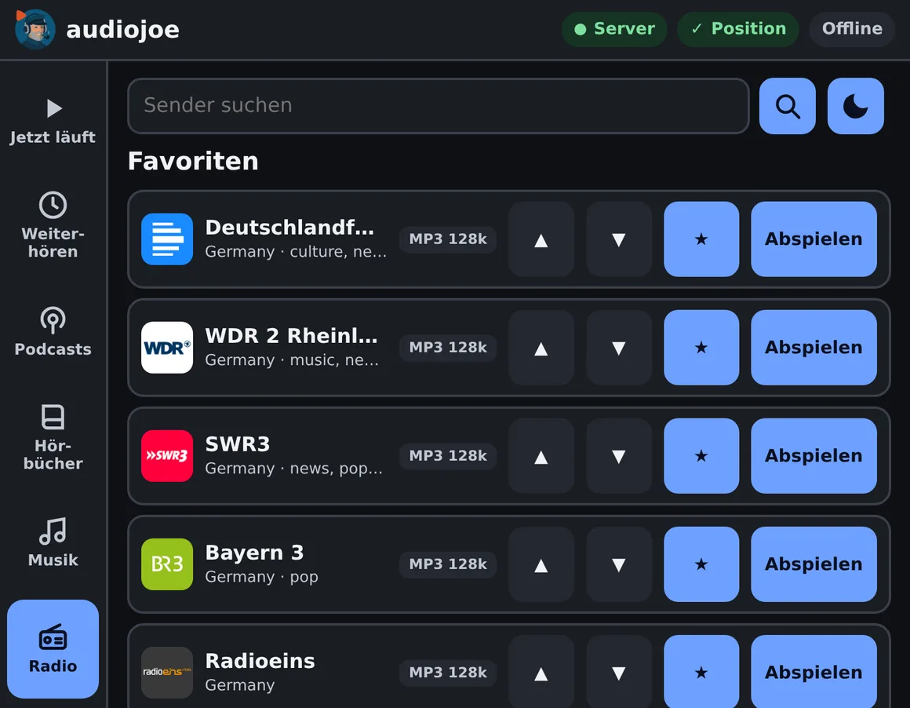

# Anleitung

audiojoe hat fünf Bereiche: **Weiterhören**, **Podcasts**, **Hörbücher**, **Musik** und
**Radio**. Die App zeigt sie unten (am Telefon) bzw. links (Desktop, Web-Player). Oben stehen der
Zustand der Verbindung und der Hörstände, der Knopf für die Offline-Titel, Hell/Dunkel und die
Einstellungen.

## Zustand oben

- **● Server** grün: der Server ist erreichbar. **Offline · Cache** gelb: keine Verbindung; die
  App spielt, was offline gespeichert ist, und merkt sich die Positionen.
- **✓ Position** grün: alle Hörstände sind beim Server. Rot mit **✕** erst, wenn eine Position
  länger als 30 Sekunden nicht gespeichert werden konnte; sie wird nachgereicht, sobald der Server
  wieder erreichbar ist.

## Weiterhören

Angefangene Folgen und Hörbücher kommen von selbst nach oben, mit **Next** (Symbol mit Liste und
Plus) hängst du Folgen, Hörbücher oder ganze Alben ans Ende an. Am Ende eines Titels spielt der
nächste Eintrag derselben Liste. Die Reihenfolge lässt sich durch Ziehen ändern; der
Papierkorb nimmt einen Eintrag heraus (bei Folgen und Hörbüchern: **Als gehört markieren**).

## Podcasts

**Neu** zeigt die neuesten Folgen aller Abonnements, **Abonniert** die Podcasts selbst. Je Folge:
abspielen, **Next**, offline speichern. Shownotes und Kapitel stehen im Player unter **Details**
und **Kapitel**.

  
  &nbsp;
  
   
  <em>Abonnierte Podcasts · Kapitel einer Folge</em>

## Radio

Sender suchen, mit dem Stern als Favorit merken, die Favoriten durch Ziehen ordnen. Radio läuft
live; es lässt sich nicht offline speichern.

  
   
  <em>Radio-Favoriten (Senderverzeichnis: Radio Browser)</em>

## Hörbücher und Musik

- **Hörbücher** (Audiobookshelf, Jellyfin, Emby, Plex): nach Autor, Serie („x von y gehört“,
  nächster Band), Titel oder zuletzt hinzugefügt; Suche nach Titel, Autor, Serie und Sprecher.
  Bei Jellyfin („Bücher“-Bibliothek), Emby („Hörbücher“) und Plex (Musikbibliothek mit dem
  Audnexus-Agenten oder mit „Hörbücher“/„Audiobooks“ im Namen) ist ein Ordner ein Buch, der
  Albuminterpret der Autor; Serien und Sprecher kennen diese Quellen nicht.
- **Musik** (Jellyfin, Emby, Plex): Alben, Künstler, Sampler, Genres, Jahre, Neu hinzugefügt und
  Labels; Suche nach Titel, Künstler, Genre und Label. **Album abspielen** spielt das ganze Album;
  ⏮ ⏭ springen zwischen den Titeln.

## Player

  
   
  <em>Player einer Podcast-Folge mit Kapiteln</em>

- **Titel und Stelle:** In einem Album steht hinter dem Titel „(3 von 14)“, bei Folgen und
  Hörbüchern mit Kapiteln hinter dem Kapitel „(1 von 21)“. Ist der Titel zu lang, läuft er durch.
- **Qualität:** Codec, Bitrate, Bittiefe und Abtastrate. Verlustfreie Formate (FLAC, ALAC, PCM)
  sind gelb bei 16 Bit und rot ab 24 Bit. Wird umgerechnet oder aus dem Cache gespielt, steht das
  dabei.
- **Bedienung:** 15 Sekunden zurück, 30 Sekunden vor. ⏮ ⏭ springen bei Kapiteln zum vorigen bzw.
  nächsten Kapitel (⏮ in den ersten 3 Sekunden eines Kapitels zum vorigen, sonst an den Anfang),
  sonst zum vorigen bzw. nächsten Titel. Sperrbildschirm und Benachrichtigung machen dasselbe.
- **Unten:** **Schlaf-Timer** (5 bis 60 Minuten, Ende des Kapitels, Ende des Titels), **Tempo**,
  **Ausgabe** (dieses Gerät oder ein Sonos-Raum) und **Offline**.
- **Lautstärke:** die des Geräts, bei Sonos die des Raums bzw. der Gruppe; Räume lassen sich zur
  Gruppe hinzufügen oder herausnehmen.

## Auf anderen Geräten weiterhören

Jede Position geht sofort an den Server; die anderen Geräte folgen, solange sie selbst nicht
spielen. Beim nächsten Start setzt ein Gerät dort fort, wo zuletzt gehört wurde – auch wenn das
auf einem anderen Gerät war – und zeigt kurz „Übernommen von …“. Lief dort ein Album, kommt das
ganze Album mit, samt ⏮ ⏭ und dem nächsten Titel.

## Offline

Folgen, Hörbücher und Alben lassen sich mit dem Pfeil nach unten speichern. Der Knopf oben (App)
bzw. **Offline** (Web-Player) zeigt, was gespeichert ist; der Web-Player auch, wie viel Platz es
belegt. Hi-Res-FLAC speichert der Web-Player als 48 kHz,
damit es im Auto läuft. Im Web-Player räumt **Gespielte Medien aus dem Cache entfernen** nach
dem Hören auf.

## Im Auto (Web-Player)

Der Web-Player ist für den Browser im Auto gebaut (große Knöpfe, Bedienung unten angedockt). Statt
des Schlaf-Timers gibt es **Nächster Podcast** bzw. **Nächstes Album**: Die laufende Folge gilt als
gehört (das Album verlässt die Liste), und der nächste Eintrag aus **Weiterhören** startet. Bei
Hörbüchern fehlt der Knopf. Auf schmaleren Bildschirmen als dem des Tesla (weniger als 420 px
rechts vom Cover) stehen die drei Knöpfe untereinander unter dem Cover, die Bedienknöpfe bleiben
rechts unten. Links in den Shownotes stehen nur als Text.

  
   
  <em>Web-Player im Format des Tesla-Bildschirms: Folge mit Kapiteln, eben vom Telefon übernommen (der Hinweis steht nur kurz da)</em>
    
  
   
  <em>Radio-Favoriten im Web-Player</em>

## Abgleich mit anderen Podcast-Apps

audiojoe spricht die gpodder.net-Schnittstelle, die AntennaPod, Kasts, gPodder und andere
Podcast-Apps für den Abgleich kennen: Abonnements und Hörstände sind dann in beiden Welten
dieselben. Diese Apps können keinen Code aus der Authenticator-App eingeben, deshalb bekommen
sie ein eigenes **App-Passwort**: in der audiojoe-App unter **Einstellungen → Abgleich mit
anderen Podcast-Apps** erzeugen (wird einmal gezeigt). In der anderen App unter
gpodder.net-Abgleich den **eigenen Server** wählen, die Adresse des audiojoe-Servers,
Benutzername und App-Passwort eintragen. Das App-Passwort gilt nur für den Abgleich, für nichts
anderes; **Abschalten** meldet alle so verbundenen Apps ab.

## Einstellungen

Quellen und Bibliotheken, Musik (Albenverzeichnis, MusicBrainz), Sonos (Lautsprecher), Pflege
(Server- und Debian-Updates, Sicherungen, Stand dieser App; siehe
[Installation](install-server.md#updates-und-pflege)), Podcasts
(OPML), Geräte (angemeldete Geräte, einzeln abmelden), **Dieses Gerät abmelden** und
**Über audiojoe** mit Version, Anleitung, Datenschutz und den Lizenzen Dritter. Im Web-Player
stehen das Abmelden und **Über audiojoe** unten auf der Seite **Offline**. Siehe [Erste Schritte](ERSTE-SCHRITTE.md).
