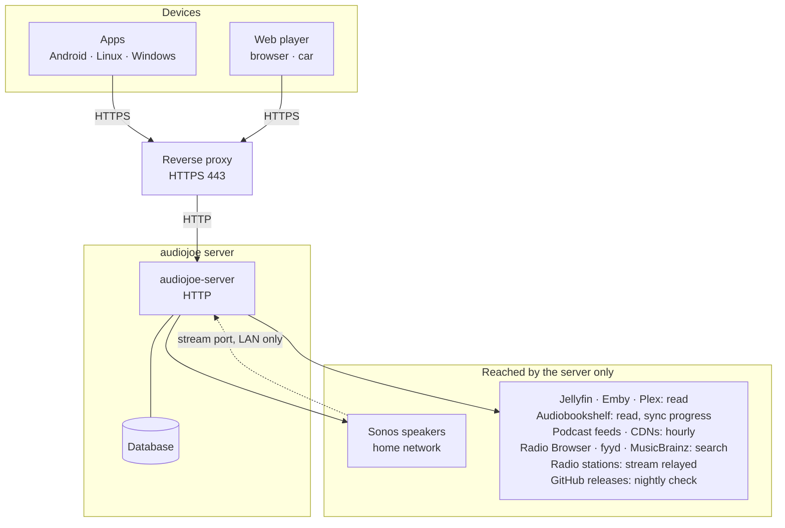
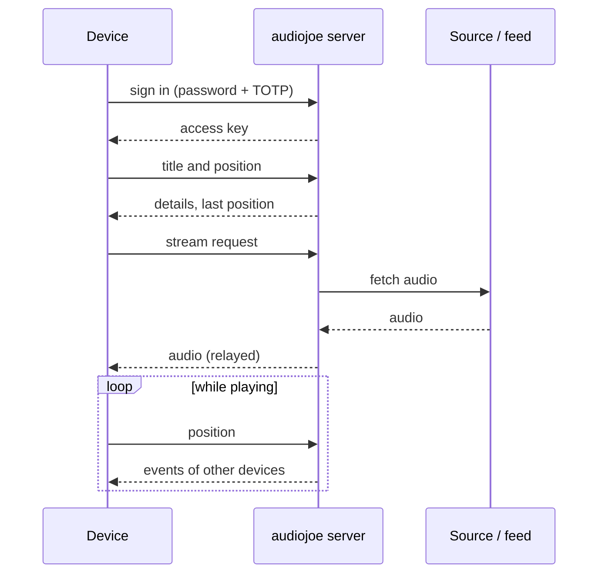

# How audiojoe works

*This page describes the current release. For an older version, see the same page under that
version's tag on GitHub (`https://github.com/joeMJ/audiojoe/tree/vX.Y.Z/docs`). The help pages
built into your server under `/docs/` always match the installed version.*

A schematic overview: who talks to whom over the network, and which data lies where. The details
of every access are in [Privacy](DATENSCHUTZ.en.md); which libraries are reachable from outside is
in [Components reachable over HTTPS](SECURITY-COMPONENTS.en.md).

## Network

The devices only talk to your audiojoe server. Everything outside – your media servers, podcast
feeds, directories, updates – is reached by the server alone.

- **Sign-in** with password and authenticator code (TOTP); the device then holds an access key.
- **Playing:** the device asks the server for the title; the server fetches the audio from the
  source, the feed or the station and relays it. It does not store the audio.
- **Positions and control:** devices send their position to the server and get changes of other
  devices through an event stream that stays open. Commands between devices (pause, take over) go
  the same way – the devices never connect to each other.
- **Offline titles** are downloaded through the server and stay on the device.
- **Updates:** the server checks GitHub at night and installs a newer package (with the server
  package). The apps only ask their own server; on a tap the server relays the installer.
- **Sonos:** the server controls the speakers in the home network; they fetch the audio from a port
  of the server's own, not through the proxy.

## Playing a title

## Where data lies

| Where | What |
|---|---|
| **Server** database `/var/lib/audiojoe/audiojoe.db` | users (password as Argon2id hash, TOTP secret), sign-ins per device (only a checksum of the access key), positions and continue lists, queues, sources with their access keys, podcasts and episodes, radio favourites, album index |
| Server configuration `/etc/audiojoe/` | listen address, proxy, Sonos section, update settings |
| Server `/var/backups/audiojoe/` | database backups before each update (the last 5) |
| Server `/var/lib/audiojoe/update-status.json` | versions, last updates (shown under Maintenance) |
| Server log (journald) | per request IP address, method, path, status, duration; 14 days in the container |
| **App** secure storage of the system | server address, access key, device name |
| App data folder | positions (also not yet sent), title data, appearance, queue; offline titles under `offline/` |
| **Web player** cookie | sign-in (`HttpOnly`, `Secure`, `SameSite=Strict`) |
| Browser storage (IndexedDB, cache, `localStorage`) | positions, title data, offline titles, appearance, views, queue |
| **Sources** (Jellyfin, Emby, Plex, Audiobookshelf) | your media; audiojoe only reads, Audiobookshelf also gets listening progress |

The server stores no media and no images. The access keys of your sources stay on the server; the
devices never see them.
