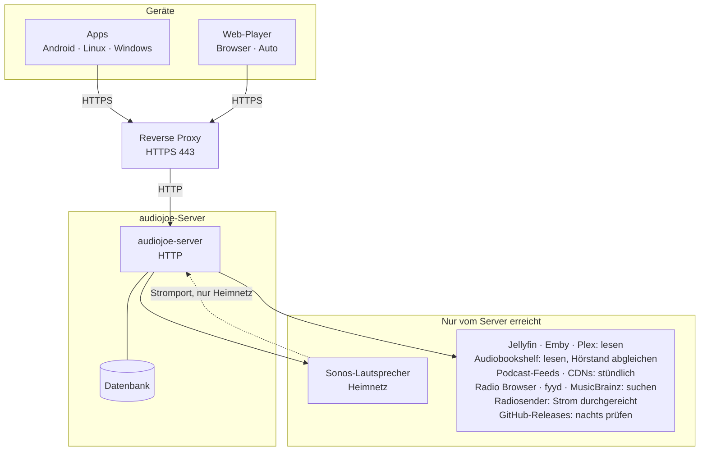
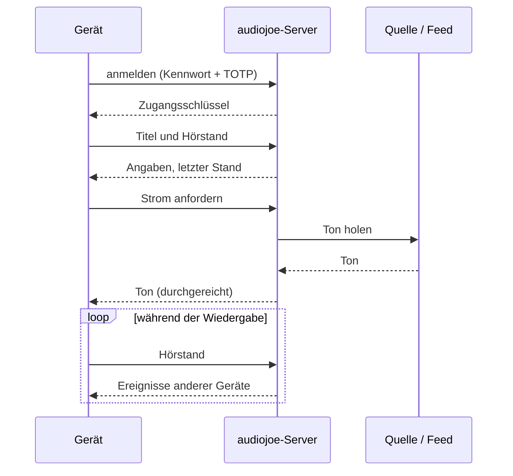

# So arbeitet audiojoe

*Diese Seite beschreibt das aktuelle Release. Für eine ältere Version gilt dieselbe Seite unter dem
Schild dieser Version auf GitHub (`https://github.com/joeMJ/audiojoe/tree/vX.Y.Z/docs`). Die im
Server eingebauten Hilfeseiten unter `/docs/` passen immer zur installierten Version.*

Ein schematischer Überblick: wer mit wem über das Netz spricht und welche Daten wo liegen. Die
Einzelheiten jedes Zugriffs stehen unter [Datenschutz](DATENSCHUTZ.md); welche Bibliotheken von
außen erreichbar sind, unter [Über HTTPS erreichbare Bestandteile](SECURITY-COMPONENTS.md).

## Netz

Die Geräte sprechen nur mit deinem audiojoe-Server. Alles außerhalb – deine Medienserver,
Podcast-Feeds, Verzeichnisse, Updates – erreicht allein der Server.

- **Anmeldung** mit Kennwort und Code der Authenticator-App (TOTP); danach hält das Gerät einen
  Zugangsschlüssel.
- **Abspielen:** Das Gerät fragt den Server nach dem Titel; der Server holt den Ton von der Quelle,
  dem Feed oder dem Sender und reicht ihn durch. Er speichert den Ton nicht.
- **Hörstände und Steuerung:** Die Geräte schicken ihren Stand an den Server und bekommen
  Änderungen anderer Geräte über einen offen bleibenden Ereignisstrom. Befehle zwischen Geräten
  (Pause, Übernehmen) laufen denselben Weg – die Geräte verbinden sich nie untereinander.
- **Offline-Titel** werden über den Server geladen und bleiben auf dem Gerät.
- **Updates:** Der Server prüft nachts GitHub und installiert ein neueres Paket (mit dem
  Server-Paket). Die Apps fragen nur ihren eigenen Server; auf Tippen reicht der Server das
  Installationspaket durch.
- **Sonos:** Der Server steuert die Lautsprecher im Heimnetz; sie holen den Ton über einen eigenen
  Port des Servers, nicht über den Proxy.

## Einen Titel abspielen

## Wo Daten liegen

| Wo | Was |
|---|---|
| **Server**-Datenbank `/var/lib/audiojoe/audiojoe.db` | Nutzer (Kennwort als Argon2id-Hash, TOTP-Geheimnis), Anmeldungen je Gerät (vom Zugangsschlüssel nur eine Prüfsumme), Hörstände und Weiterhören-Listen, Warteschlangen, Quellen mit ihren Zugangsschlüsseln, Podcasts und Folgen, Radio-Favoriten, Albumverzeichnis |
| Server-Konfiguration `/etc/audiojoe/` | Listen-Adresse, Proxy, Sonos-Abschnitt, Update-Einstellungen |
| Server `/var/backups/audiojoe/` | Sicherungen der Datenbank vor jedem Update (die letzten 5) |
| Server `/var/lib/audiojoe/update-status.json` | Versionen, letzte Updates (Anzeige unter Wartung) |
| Server-Protokoll (journald) | je Anfrage IP-Adresse, Methode, Pfad, Status, Dauer; im Container 14 Tage |
| **App** sicherer Speicher des Systems | Server-Adresse, Zugangsschlüssel, Gerätename |
| Datenordner der App | Hörstände (auch noch nicht gesendete), Titeldaten, Darstellung, Warteschlange; Offline-Titel unter `offline/` |
| **Web-Player** Cookie | Anmeldung (`HttpOnly`, `Secure`, `SameSite=Strict`) |
| Browser-Speicher (IndexedDB, Cache, `localStorage`) | Hörstände, Titeldaten, Offline-Titel, Darstellung, Ansichten, Warteschlange |
| **Quellen** (Jellyfin, Emby, Plex, Audiobookshelf) | deine Medien; audiojoe liest nur, Audiobookshelf bekommt zusätzlich den Hörstand |

Der Server speichert keine Medien und keine Bilder. Die Zugangsschlüssel deiner Quellen bleiben auf
dem Server; die Geräte sehen sie nie.
