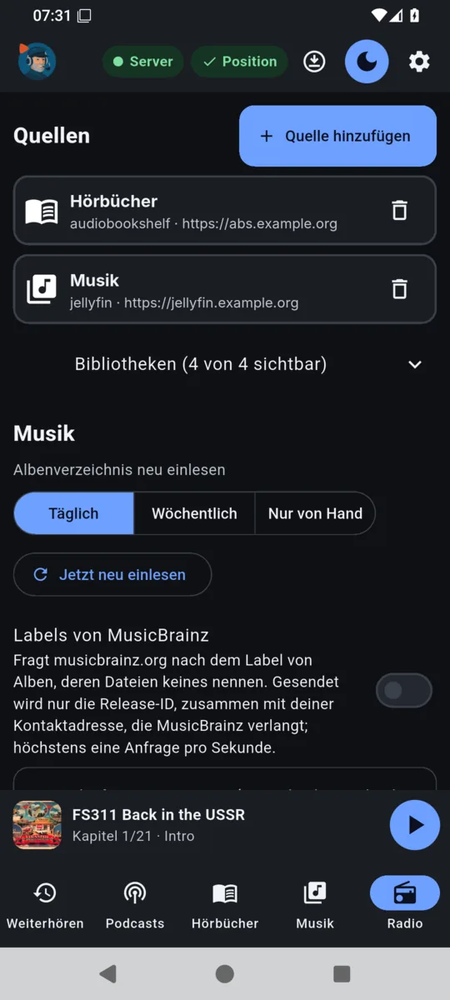

# Getting started

You need a running audiojoe server ([Installation](INSTALLATION.en.md)) and an authenticator app on
your phone (e.g. Aegis, 2FAS, FreeOTP or the one of your password manager). The screenshots show
the German interface.

## Adding users

The operator adds users on the server, as the service's user:

```bash
runuser -u audiojoe -- audiojoe-server user add anna
```

The command prints a random password, the TOTP secret and an `otpauth://` address once. Enter the
secret or the address in the authenticator app. More commands: `user passwd NAME` (new password),
`user totp-reset NAME` (new secret; signs out all devices), `user list`, `user delete NAME`. With
`--password-file FILE` the password is read from a file instead of generated.

## Signing in

**App** (Android, Linux, Windows): enter the server address (e.g. `https://audio.example.org`),
user name, password, the **code from the authenticator app** and a **device name**. Positions
("Taken over from …") and the sign-in in the device list appear under this name. On the desktop the
app suggests "system · host name"; if you do not want to give the host name to the server, change
it here.

**Web player** (e.g. in the car's browser): open the server address in the browser and sign in the
same way.

A sign-in is valid for 180 days. **Settings → Devices** lists all devices; each can be signed out on
its own.

## Adding sources

In the app under **Settings → Add source**:

| Kind | Address | Key |
|---|---|---|
| Jellyfin | e.g. `https://jellyfin.example.org` | API key (Jellyfin: Dashboard → API Keys) |
| Emby | address of the Emby server | API key (in Emby's server administration) |
| Plex | e.g. `http://plex.example.org:32400` | `X-Plex-Token` of the Plex account |
| Audiobookshelf | e.g. `https://abs.example.org` | API key of an Audiobookshelf user |

The server checks the connection when saving. Keys stay on the server; the apps do not see them.
Sources apply to all users of the server. audiojoe syncs the Audiobookshelf progress for the user
who added the source.

Below each source, **Libraries** hides single libraries (e.g. radio plays in a music library); this
applies to your own user on all devices.

<p align="center">
  
  <br>
  <em>Settings (source addresses replaced by examples here)</em>
</p>

## Subscribing to podcasts

- **Podcasts → Add podcast:** search for a name (via [fyyd](https://fyyd.de)) or enter the feed
  address.
- **Moving from another app:** export the subscriptions there as an OPML file and read it into
  audiojoe under **Settings → Podcasts → Import OPML**. **Export OPML** writes your subscriptions
  to a file.

## Radio

**Radio → Search stations**, then keep a station as favourite with the star. The stations come from
the free directory [Radio Browser](https://www.radio-browser.info).

## Music

When a music library is opened for the first time, the server builds an album index of its own;
afterwards it checks daily whether anything changed (**Settings → Music**: daily, weekly or by hand
only; **Read in again now**). When the files name no label, the server can look it up at
MusicBrainz (**Labels from MusicBrainz**, off by default; it needs a contact address, which
MusicBrainz asks for – see [Privacy](DATENSCHUTZ.en.md)).

## Sonos

Sonos needs a second port of the server, reachable only in the home network
([Installation](INSTALLATION.en.md#sonos)). Add speakers under **Settings → Sonos**: enter the IP
address and **Add speaker**, or – when the configuration has a range `[sonos] scan` – search that
range. They can be removed there too; speakers apply to all users of the server. Then the rooms can
be picked in the player under **This device**.
