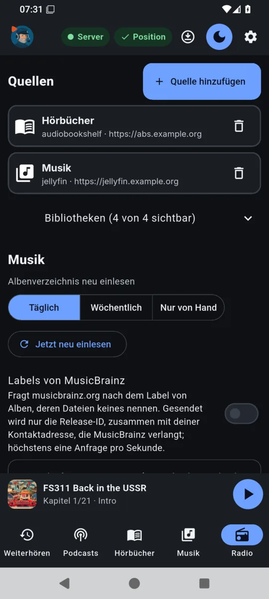

# Erste Schritte

Voraussetzung ist ein laufender audiojoe-Server ([Installation](INSTALLATION.md)) und eine
Authenticator-App auf dem Telefon (z. B. Aegis, 2FAS, FreeOTP oder die des Passwortmanagers).

## Benutzer anlegen

Benutzer legt der Betreiber auf dem Server an, als Benutzer des Dienstes:

```bash
runuser -u audiojoe -- audiojoe-server user add anna
```

Der Befehl gibt einmal ein zufälliges Passwort, den TOTP-Schlüssel und eine `otpauth://`-Adresse
aus. Schlüssel oder Adresse in die Authenticator-App übernehmen. Weitere Befehle:
`user passwd NAME` (neues Passwort), `user totp-reset NAME` (neuer Schlüssel; meldet alle Geräte
ab), `user list`, `user delete NAME`. Mit `--password-file DATEI` wird das Passwort aus einer
Datei gelesen statt erzeugt.

## Anmelden

**App** (Android, Linux, Windows): Server-Adresse (z. B. `https://audio.example.org`),
Benutzername, Passwort, den **Code aus der Authenticator-App** und einen **Gerätenamen** eintragen.
Unter dem Gerätenamen erscheinen Hörstände („Übernommen von …“) und die Anmeldung in der
Geräteliste. Auf dem Desktop schlägt die App „System · Rechnername“ vor; wer den Rechnernamen
nicht an den Server geben möchte, ändert ihn hier.

**Web-Player** (z. B. im Browser des Autos): die Server-Adresse im Browser öffnen und genauso
anmelden.

Eine Anmeldung gilt 180 Tage. Alle Geräte stehen unter **Einstellungen → Geräte**; dort lässt sich
jedes einzeln abmelden.

## Quellen eintragen

In der App unter **Einstellungen → Quelle hinzufügen**:

| Art | Adresse | Schlüssel |
|---|---|---|
| Jellyfin | z. B. `https://jellyfin.example.org` | API-Schlüssel (Jellyfin: Dashboard → API-Schlüssel) |
| Emby | Adresse des Emby-Servers | API-Schlüssel (in der Serververwaltung von Emby) |
| Plex | z. B. `http://plex.example.org:32400` | `X-Plex-Token` des Plex-Kontos |
| Audiobookshelf | z. B. `https://abs.example.org` | API-Schlüssel eines Audiobookshelf-Benutzers |

Der Server prüft die Verbindung beim Speichern. Schlüssel bleiben auf dem Server; die Apps sehen
sie nicht. Quellen gelten für alle Benutzer des Servers. Den Hörfortschritt von Audiobookshelf
gleicht audiojoe für den Benutzer ab, der die Quelle angelegt hat.

Unter jeder Quelle lassen sich mit **Bibliotheken** einzelne Bibliotheken ausblenden (z. B.
Hörspiele in einer Musikbibliothek); das gilt für den eigenen Benutzer auf allen Geräten.

<p align="center">
  
  <br>
  <em>Einstellungen (Adressen der Quellen hier durch Beispiele ersetzt)</em>
</p>

## Podcasts abonnieren

- **Podcasts → Podcast hinzufügen:** einen Namen suchen (über [fyyd](https://fyyd.de)) oder die
  Feed-Adresse eintragen.
- **Von einer anderen App umziehen:** dort die Abonnements als OPML-Datei exportieren und in
  audiojoe unter **Einstellungen → Podcasts → OPML importieren** einlesen. **OPML exportieren**
  schreibt die eigenen Abonnements in eine Datei.

## Radio

**Radio → Sender suchen**, dann mit dem Stern als Favorit merken. Die Sender kommen aus dem freien
Verzeichnis [Radio Browser](https://www.radio-browser.info).

## Musik

Beim ersten Öffnen einer Musikbibliothek baut der Server ein eigenes Albenverzeichnis auf; danach
prüft er täglich, ob sich etwas geändert hat (**Einstellungen → Musik**: täglich, wöchentlich oder
nur von Hand; **Jetzt neu einlesen**). Fehlt in den Dateien das Label, kann der Server es auf Wunsch
bei MusicBrainz nachschlagen (**Labels von MusicBrainz**, standardmäßig aus; dafür ist eine
Kontaktadresse nötig, die MusicBrainz verlangt – siehe [Datenschutz](DATENSCHUTZ.md)).

## Sonos

Sonos braucht einen zweiten, nur im Heimnetz erreichbaren Port des Servers
([Installation](INSTALLATION.md#sonos)). Lautsprecher lassen sich derzeit nur über die
Schnittstelle des Servers eintragen (`POST /api/v1/sonos` mit `{"ip": "…"}` oder
`POST /api/v1/sonos/scan` für den Bereich aus `[sonos] scan`); eine Bedienung in den Einstellungen
folgt. Danach stehen die Räume im Player unter **Dieses Gerät** zur Auswahl.
